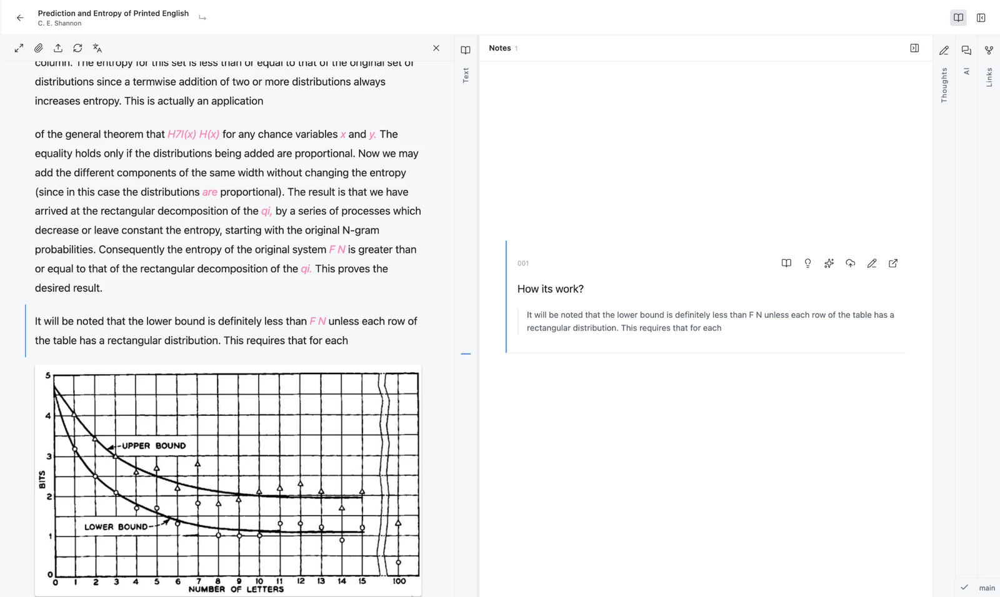
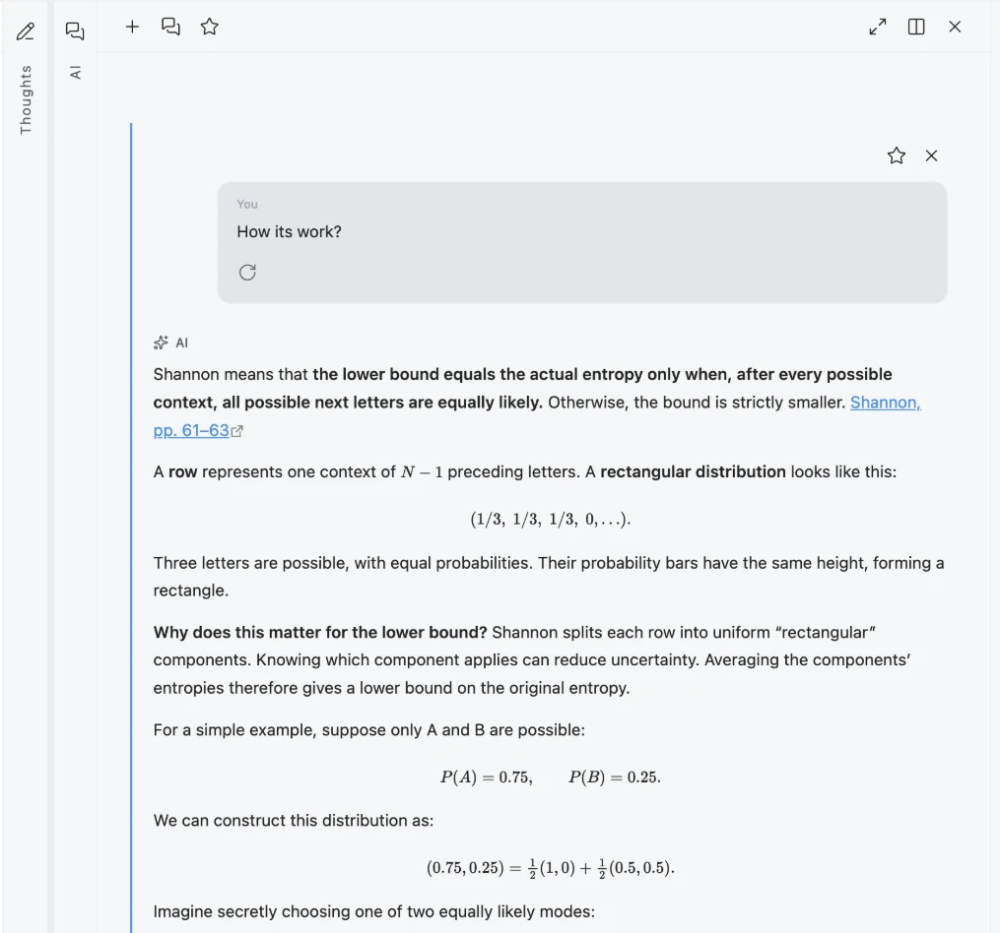
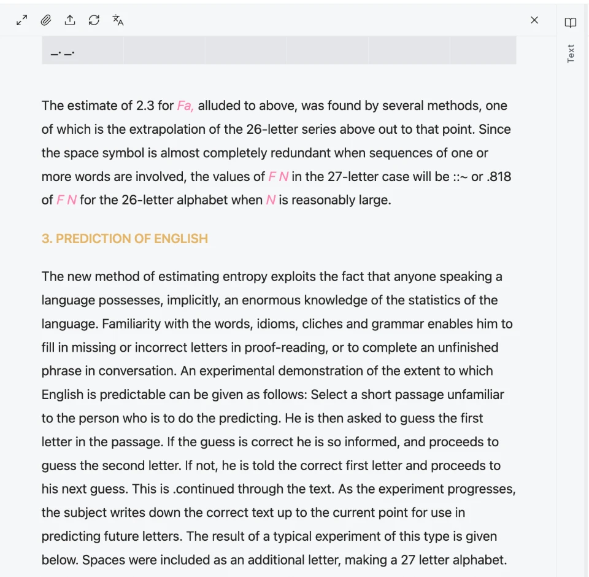

# Readwise Reading Tracker 1.3.0

Version 1.3.0 adds the **book workspace**: read a book's full text next to your highlights, write thoughts, link texts together and, optionally, discuss the book with AI. Everything is stored as plain Markdown notes in your vault.

You can still read books the way you always do, in Readwise Reader. The workspace is for the next step: working through your notes in depth and coming back to them easily. Each thought, link and AI conversation stays attached to the passage that prompted it, so over time your reading grows into a network of connected articles and discussions on the topics that came up while you read.

Open it with **Detailed review** on a book in the highlights sidebar, or with the command **Readwise Reading Tracker: Open book workspace**.

## Book workspace

- The full text sits on the left; thoughts, AI dialogs and links to other texts sit on the right. Scrolling any area brings the related notes and passages into view in the others.
- A reading line follows your position: the note under it becomes the active one.
- Panels are labelled **Text**, **Thoughts**, **AI**, **Links**. Collapse notes to keep only the text and one thought side by side; drag the divider to resize. On narrow screens the open areas stack vertically.
- A book map shows where your notes are in the text and jumps to any place.
- Mark a thought or dialog with a star to find it later; the panel can show only the important ones.
- Your position, open panels, widths and scroll offsets are restored when you come back.



## Thoughts and links between texts

- **+** creates a thought or a dialog for the current note. Thoughts are ordinary Markdown.
- Link a note to other sources, including notes from elsewhere in your vault, and describe the connection in your own words.
- A link to another text opens that text's workspace; the arrow at the top returns to where you came from. Incoming links show the text they came from.

## AI dialogs (optional, through Codex Bridge)

AI answers use the separate [Codex Bridge](https://github.com/free-solo-lab/obsidian-codex-bridge) plugin (1.0.0 or newer, desktop only). Without it the workspace works as a reader and note editor. No new API keys and no separate server.

- Ask a question from any note; the answer is saved in the dialog's own Markdown file. Send with **Cmd/Ctrl+Enter**; stop and retry are one click away.
- All questions about a book share one persistent Codex thread that remembers earlier questions and answers. The **Book chat** shows the whole feed.
- A note's dialog sees only that note by default; switch it to the whole book conversation with the library button.
- Formulas in answers are rendered as math. Copy an answer or save it as a thought.
- Optional: let AI search the web and use Readwise tools (**Settings → Let AI search the web and use Readwise**). It is off by default; shell and file access are never enabled.
- Quotes and comments from your notes are sent to OpenAI through Codex only when you send a question (and book text only when you ask for a translation).



## Full text and file import

- The text of a book is found in this order: a text or original already in your vault, the `Full Document` link of the official Readwise export, the Reader API, or a file you choose. Once fetched, it is available offline.
- Import **HTML, EPUB, PDF (with a text layer), TXT and Markdown** from the right-click menu or with the paperclip (vault file) and upload (local file) buttons above the text. Originals are saved in `_Assets`, images are kept, and tables stay tables. PDF text is extracted locally; nothing is uploaded for processing.
- Quote matching handles Markdown formatting, typographic quotes and PDF line breaks. Ambiguous quotes ask you to choose the match instead of guessing. Image-only highlights are matched by address or content hash.
- Translate the book text with **Translate to…** (through Codex Bridge, so the translated passages are sent to OpenAI via Codex) and switch back to the original at any time; the last view is remembered per book.



## Reader progress (optional)

**Send reading progress to Reader** mirrors your position in the workspace to Reader after a pause, so you can continue there. A book read to the end is archived. Off by default; not available for PDFs.

## Highlights and dashboard

- Linked highlight notes keep image-only highlights, multi-line quotes and LLM Q/A comments intact. YAML string fields are quoted, so titles with colons or wikilinks stay valid properties.
- The highlights sidebar recovers legacy numbering from file names and reads metadata even when an invalid YAML header keeps Obsidian from caching it, so sorting works without rewriting existing notes.
- The tag filter folds to two rows with a "…" disclosure, so large tag sets no longer take over the panel.

## Quality and privacy

- Notes, dialogs and links are plain Markdown with stable ids; the index is rebuilt from your files. A conflict with an external edit saves a separate `conflict` file and leaves the original untouched.
- Plugin data stays in your vault. The plugin sends data only to Readwise (sync and Reader, as before) and, if you use AI, to Codex through Codex Bridge.
- Production dependency audit reports zero known vulnerabilities.

Full description of the workspace: [docs/BOOK_WORKSPACE.md](https://github.com/free-solo-lab/obsidian-readwise-tracker/blob/1.3.0/docs/BOOK_WORKSPACE.md).

## Installation

Download `main.js`, `manifest.json` and `styles.css` from this release and place them in:

```text
.obsidian/plugins/readwise-reading-tracker/
```

Restart Obsidian or reload the plugin after replacing the files.
